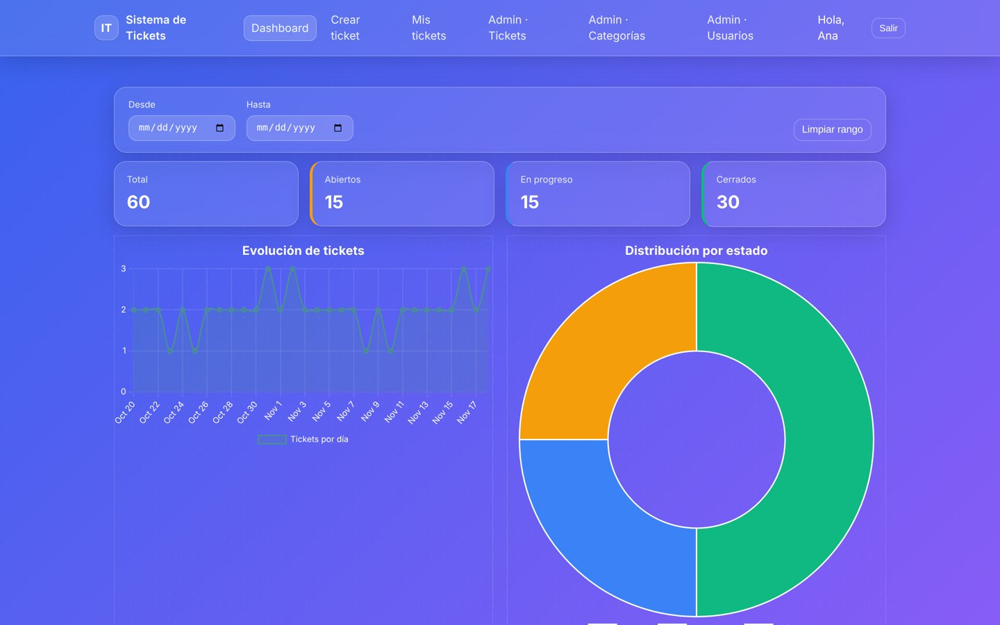
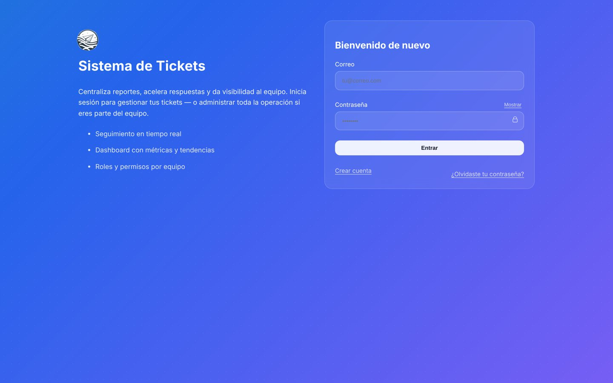
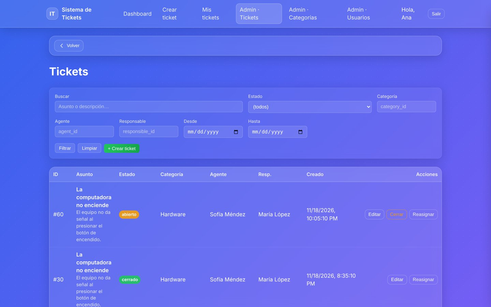

# Sistema de Tickets

Aplicación web full-stack para gestionar tickets de soporte técnico por departamento y categoría, con roles, dashboard de métricas y actualizaciones en tiempo real.

> **EN:** Full-stack help-desk ticketing app (Next.js 15 + React 19, Express 5, PostgreSQL). JWT auth with token revocation, role-based access, real-time updates via PostgreSQL `LISTEN/NOTIFY` + Server-Sent Events, a Chart.js metrics dashboard, integration tests, k6 load tests and a one-command Docker setup.



## Funcionalidades

- **Tickets**: crear, asignar a un agente, cambiar estado (abierto, en progreso, cerrado) y buscar con filtros por texto, estado, categoría, fechas y vista (como agente o como responsable), con paginación y orden.
- **Roles y permisos**: superadmin, admin y auxiliar. Un auxiliar solo ve los tickets donde es agente o responsable, y solo el agente asignado o un admin pueden cerrarlos o borrarlos. Las reglas se validan en el servidor.
- **Autenticación**: JWT con `jti`, cierre de sesión que revoca el token (lista negra en la base de datos), recuperación de contraseña por correo con token de un solo uso (se guarda solo su hash SHA-256) y contraseñas con bcrypt.
- **Tiempo real**: un trigger de PostgreSQL emite `NOTIFY` en cada cambio de un ticket; el backend lo reenvía por Server-Sent Events y las pantallas se actualizan solas (con polling de respaldo).
- **Dashboard**: totales por estado, tickets por día, por categoría y por agente (Chart.js), con filtro por rango de fechas.
- **Administración**: usuarios, categorías, departamentos y consulta de tokens revocados.

| Inicio de sesión | Administración de tickets |
|---|---|
|  |  |

## Stack

| Capa | Tecnologías |
|---|---|
| Frontend | Next.js 15 (App Router), React 19, Chart.js, CSS propio con estilo glassmorphism |
| Backend | Node.js, Express 5, arquitectura por capas (rutas, controladores, servicios), JWT, bcrypt, Nodemailer, helmet, express-rate-limit |
| Base de datos | PostgreSQL 16: llaves foráneas, `CHECK`, índices y triggers (`updated_at` y `NOTIFY`) |
| Pruebas | `node:test` + Supertest (integración), k6 (carga), colecciones REST Client |
| DevOps | Docker Compose, GitHub Actions (pruebas del API contra PostgreSQL y build del frontend) |

## Arquitectura

```
Navegador (Next.js) ──REST + JWT──▶ Express 5 ──SQL──▶ PostgreSQL
        ▲                              │  ▲                 │
        └──── Server-Sent Events ──────┘  └── LISTEN ◀── NOTIFY (trigger en tickets)
```

```
backend/
  app.js            configuración de Express (CORS, helmet, rutas, errores)
  index.js          arranque, listener de tiempo real y limpieza de tokens
  routes/           endpoints y middlewares de autenticación por rol
  controllers/      validación y reglas de permisos
  services/         consultas SQL parametrizadas
  db/               schema.sql y seed.sql
  test/api/         pruebas de integración
  test/load/        scripts y resultados de k6
frontend/src/
  app/              páginas (App Router)
  components/       tablas, formularios, navegación
  hooks/            useTable (paginación y filtros), useSSERefresh, useAuth
```

## Cómo ejecutarlo

### Opción 1: Docker (recomendada)

```bash
docker compose up --build
```

- Frontend: http://localhost:3000
- API: http://localhost:4000/api

La base se crea con datos de demostración la primera vez. Todas las cuentas usan la contraseña `Demo1234!`:

| Rol | Correo |
|---|---|
| Superadmin | superadmin@demo.com |
| Admin | admin@demo.com |
| Auxiliar (agente) | agente@demo.com |
| Auxiliar (solicitante) | carlos@demo.com |

### Opción 2: local

Requisitos: Node.js 20+ y PostgreSQL 14+.

```bash
# Base de datos
createdb sistema_tickets
psql -d sistema_tickets -f backend/db/schema.sql
psql -d sistema_tickets -f backend/db/seed.sql

# API
cd backend
cp .env.example .env      # completa DB_* y JWT_SECRET (openssl rand -hex 32)
npm install
npm run dev               # http://localhost:4000

# Frontend (en otra terminal)
cd frontend
cp .env.example .env.local
npm install
npm run dev               # http://localhost:3000
```

## Pruebas

**Integración** (13 casos: autenticación, revocación de tokens, permisos por rol, filtros, intento de inyección SQL, cifrado de contraseñas):

```bash
cd backend
npm test        # necesita la base con schema.sql y seed.sql
```

**Carga con k6** (`backend/test/load/k6_tickets.js`): login y consultas a `/api/tickets` y `/api/tickets/paged`.

| Usuarios virtuales | Peticiones | Errores | Latencia media | p95 |
|---|---|---|---|---|
| 20 | 4,695 | 0 % | 14.4 ms | 36.8 ms |

```bash
k6 run -e VUS=20 -e DURATION=2m backend/test/load/k6_tickets.js
```

El resultado completo está en `backend/test/load/results/`.

## Seguridad

- Consultas SQL parametrizadas y lista blanca de columnas para ordenar.
- Contraseñas con bcrypt; tokens de recuperación guardados como hash y con expiración.
- JWT con expiración y revocación al cerrar sesión; en producción el servidor no arranca sin un `JWT_SECRET` de al menos 32 caracteres.
- Límite de intentos en login, registro y recuperación de contraseña.
- CORS con lista blanca y cabeceras de seguridad con helmet.
- Los secretos viven en `.env`, que está fuera del repositorio (ver `.env.example`).
